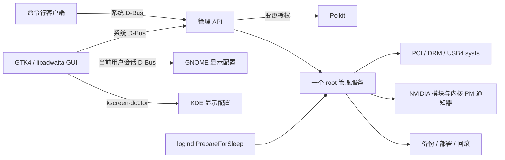

# 架构

`hardware.py` 只读获取 GPU、连接器、USB4、参数、指标和 GPU 设备文件占用。
目标选择由 PCI vendor/device 表示，运行时重新解析地址，不固定 card 编号或 BDF。
同型号多卡无法唯一确定时拒绝操作；首版尚未按序列号区分同型号卡。

`presence.py` 仅读取 USB4 路由器标识与 PCI 目录是否存在，不接触 NVIDIA DRM/NVML，
不等待设备操作锁。路由器已消失但 PCI 条目残留时标为驱动清理未完成，不能继续报告已连接。
详细样本超过 10 秒即清空指标、禁用设备操作；客户端也对旧后台数据应用相同保护。

`probe.py` / `worker.py` 隔离可能阻塞的状态查询和 sysfs 写入。
`system.py` 在超时后只做有限时间的终止与回收尝试；若子进程仍陷于内核等待，
保留它的句柄并阻止同类重复请求，不让主服务等待到无穷，也不反复堆积阻塞进程。
这保证连接状态和 API 可响应，无法保证修复已经发生的 GPU 驱动死锁。

`core/controller.py` 序列化变更，管理自动连接、稳定等待、睡眠事件和移除预约。
服务启动、设备消失/出现和系统唤醒均重置稳定判断，路径和 BAR0 稳定后才加载驱动。
部署轮次与当前启动相同会等待重启，避免在运行的桌面上切换驱动策略。
`core/policy.py` 只派生自动策略判断、BAR 签名与候选配置；
`core/operations.py` 实现驱动加载、成对切换与最终移除检查。
这些方法使用同一个 Controller 的锁、事件和状态，不维护独立状态机。

`deployment.py` 渲染固定路径配置，保存原文件内容、权限和属主。
迁移失败恢复文件并再次重建 initramfs；最近部署可从 GUI 或 root 恢复命令回滚。
旧自定义服务及 drop-in 收敛到主服务，厂商服务不删除。

`daemon.py` 只暴露状态、日志、预览与有限动作，不提供任意 shell 或任意路径写入。
GUI 和 CLI 通过系统 D-Bus 调用，读状态无需 root，所有 GPU / 系统配置变更请求独立授权。

`desktop/gnome.py` 在普通用户进程中调用 GNOME Mutter 的会话 D-Bus，独立控制外屏。
按 root 状态中的 PCI → DRM 连接器对应到桌面屏幕；接口名重复、物理/桌面状态不一致时拒绝变更。
逻辑输出状态来自 `GetCurrentState`，不会把 idle DPMS 息屏误认作外屏被停用。
停用需另一张 GPU 的内屏已加入桌面布局；排除目标外屏后保留其他输出的模式、缩放、旋转、镜像成员和颜色属性，横向压紧避免布局空洞。
先用 method=0 校验，再用 method=1 临时应用，备份原配置到当前用户状态目录。
恢复要求 GPU、屏幕身份和停用后布局均匹配，并使用新的配置 serial；不会覆盖后来手动更改的布局。
这些操作不经过 root 服务，不隐式注销、删除 PCI 设备或结束 GPU 任务。

`desktop/kde.py` 使用 KScreen 的原生输出配置及 EDID 身份校验，
与 GNOME 只共享 `desktop/common.py` 的连接器所有权、会话锁和备份位置。
KDE 不继承 GNOME 的协议实现；两者仍保留各自的配置确认及恢复条件。

## 客户端与服务生命周期

`ui/application.py` 管理 GTK 应用、托盘和退出；
`ui/window.py` 管理状态刷新、交互与确认；
`ui/pages.py` 装配页面；`ui/components.py` 提供公共组件；
`ui/state.py` 计算忙碌、移除确认和退出所需的会话收尾状态；
`ui/requests.py` 使用固定数量的后台线程执行会话请求。
GTK 初始化集中在 `ui/gtk.py`，语言和渲染器设置必须先于 GI 加载。
页面控件、尺寸、间距及样式沿用原布局。

关闭窗口在托盘可用时隐藏；托盘退出和页面退出按钮只退出客户端。
服务的自动管理、设备监控、已接受的连接/部署操作和移除预约继续运行。
退出不调用取消预约或停止服务，也不改变持久化的自动管理开关。
重新打开客户端通过 GetStatus 读取已有任务；取消仍需显式点击取消请求。

会话显示变更及内置显卡卸载的 WirePlumber 停止/恢复属于客户端资源。
退出时立即隐藏窗口、停止刷新和自动注销，等待这些已发出的本地请求完成收尾后退出。
远端授权或 RPC 的等待线程不会单独阻止进程结束。
尚未完成授权、未被服务接受的请求不能视为已经提交。
内置卸载继续等待服务的同步回执再恢复音频，保持原有补偿顺序。
退出收尾失败会记录客户端错误日志，不会取消已经由服务接受的任务。

`contracts.py` 统一动作集合、允许字段和忙碌状态，客户端和服务共享契约；
`logind.py` 统一睡眠/关机 inhibitor 的获取与释放。
原 `gui/controller/displays/kde_displays` 路径保留兼容入口，业务实现只有一份。

## 安装文件与包路径

源码安装和 DEB/RPM staging 共用 `packaging/files.py` 的文件清单。
Python 代码递归复制并保留包路径，翻译提取与检查也递归发现子包。
安装入口仍独立负责依赖检查、升级保护和服务启停；
staging 只复制文件。源码安装保留 `/etc` 的服务/总线配置位置，
原生包保留 `/usr/lib` 和 `/usr/share` 的对应位置。
`probe/worker` 的路径与隔离进程入口保持不变，避免破坏 `python -I` 启动。

## 安全移除

状态：已连接 → 重新检查 → 已移除，或已连接 → 等待注销 → 重新检查 → 已移除。
直接移除时，显示器状态未知、进程持有设备文件、设备身份变化、非可移除/启动/内屏 GPU 均阻止移除。
外屏线仍连接时，必须由 root 重新读取并确认所有外接接口均为 disabled、连接状态已知、另一张 GPU 的内屏 enabled。
后台不信任客户端“已经关闭屏幕”的断言；停用外屏也不能绕过 GPU 占用检查。
注销流程可在用户明确同意外屏停止输出、另一张 GPU 的内屏已启用后移除仍接着显示器的卡；
这条路径依然要求所有 GPU 进程释放句柄、所有连接状态可读，并在移除前重新验证内屏。
预约通过 /run/udev/rules.d 临时给目标 DRM 卡增加 Mutter ignore 标签，
让后续 GNOME 会话不重新打开它。标签不强迫当前会话释放设备。
释放后仍再次检查，再写目标 PCI 功能的 remove；不删除整个 USB4/PCIe 桥。
移除后保留共享 NVIDIA/VFIO 模块，避免 softdep 连带破坏内置显卡隔离；
只删除目标 GPU 和音频 PCI 功能。
成功、取消、超时与服务停止均清理临时规则；异常退出时在重启服务后恢复清理。

Linux 没有对所有 eGPU 驱动和桌面都适用的安全弹出事务。
这些检查避免已知活跃使用情形，但进程检查和设备移除之间仍有很小的并发窗口。
实际 NVIDIA/USB4 热移除仍需实机验证。

## 范围

首版聚焦 Ubuntu/Debian、initramfs-tools、支持内核 PM 通知器的 NVIDIA 开源驱动和 GNOME。
AMD eGPU、dracut、非 GNOME 注销协调、多张同型号 GPU、扩展坞存储卸载、
驱动包自动选型和安装不在首版自动管理范围。
