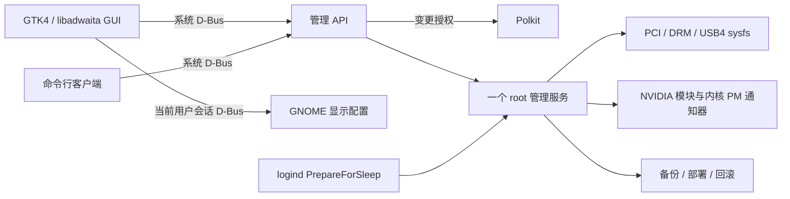

# 架构

`hardware.py` 只读获取 GPU、连接器、USB4、参数、指标和 GPU 设备文件占用。
目标选择由 PCI vendor/device 表示，运行时重新解析地址，不固定 card 编号或 BDF。
同型号多卡无法唯一确定时拒绝操作；首版尚未按序列号区分同型号卡。

`presence.py` 仅读取 USB4 路由器标识与 PCI 目录是否存在，不接触 NVIDIA DRM/NVML，
不等待设备操作锁。路由器已消失但 PCI 条目残留时标为驱动清理未完成，不能继续报告已连接。
详细样本超过 10 秒即清空指标、禁用设备操作；客户端也对旧后台数据应用相同保护。

`probe.py` / `worker.py` 隔离可能阻塞的状态查询和 sysfs 写入。
`system.py` 在超时后只做有限时间的终止与回收尝试；若子进程仍陷于内核等待，
保留它的句柄并阻止同类重复请求，不让主服务等待到无穷，也不反复堆积阻塞进程。
这保证连接状态和 API 可响应，无法保证修复已经发生的 GPU 驱动死锁。

`controller.py` 序列化变更，管理自动连接、稳定等待、睡眠事件和移除预约。
服务启动、设备消失/出现和系统唤醒均重置稳定判断，路径和 BAR0 稳定后才加载驱动。
部署轮次与当前启动相同会等待重启，避免在运行的桌面上切换驱动策略。

`deployment.py` 渲染固定路径配置，保存原文件内容、权限和属主。
迁移失败恢复文件并再次重建 initramfs；最近部署可从 GUI 或 root 恢复命令回滚。
旧自定义服务及 drop-in 收敛到主服务，厂商服务不删除。

`daemon.py` 只暴露状态、日志、预览与有限动作，不提供任意 shell 或任意路径写入。
GUI 和 CLI 通过系统 D-Bus 调用，读状态无需 root，所有 GPU / 系统配置变更请求独立授权。

`displays.py` 在普通用户进程中调用 GNOME Mutter 的会话 D-Bus，独立控制外屏。
按 root 状态中的 PCI → DRM 连接器对应到桌面屏幕；接口名重复、物理/桌面状态不一致时拒绝变更。
逻辑输出状态来自 `GetCurrentState`，不会把 idle DPMS 息屏误认作外屏被停用。
停用需另一张 GPU 的内屏已加入桌面布局；排除目标外屏后保留其他输出的模式、缩放、旋转、镜像成员和颜色属性，横向压紧避免布局空洞。
先用 method=0 校验，再用 method=1 临时应用，备份原配置到当前用户状态目录。
恢复要求 GPU、屏幕身份和停用后布局均匹配，并使用新的配置 serial；不会覆盖后来手动更改的布局。
这些操作不经过 root 服务，不隐式注销、删除 PCI 设备或结束 GPU 任务。

## 安全移除

状态：已连接 → 重新检查 → 已移除，或已连接 → 等待注销 → 重新检查 → 已移除。
直接移除时，显示器状态未知、进程持有设备文件、设备身份变化、非可移除/启动/内屏 GPU 均阻止移除。
外屏线仍连接时，必须由 root 重新读取并确认所有外接接口均为 disabled、连接状态已知、另一张 GPU 的内屏 enabled。
后台不信任客户端“已经关闭屏幕”的断言；停用外屏也不能绕过 GPU 占用检查。
注销流程可在用户明确同意外屏停止输出、另一张 GPU 的内屏已启用后移除仍接着显示器的卡；
这条路径依然要求所有 GPU 进程释放句柄、所有连接状态可读，并在移除前重新验证内屏。
预约通过 /run/udev/rules.d 临时给目标 DRM 卡增加 Mutter ignore 标签，
让后续 GNOME 会话不重新打开它。标签不强迫当前会话释放设备。
释放后仍再次检查，再写目标 PCI 功能的 remove；不删除整个 USB4/PCIe 桥。
移除后若没有其他 NVIDIA GPU 绑定，尝试正常卸载空闲 NVIDIA 模块，防止重插时过早探测；有引用则保留，不强制卸载。
成功、取消、超时与服务停止均清理临时规则；异常退出时在重启服务后恢复清理。

Linux 没有对所有 eGPU 驱动和桌面都适用的安全弹出事务。
这些检查避免已知活跃使用情形，但进程检查和设备移除之间仍有很小的并发窗口。
实际 NVIDIA/USB4 热移除仍需实机验证。

## 范围

首版聚焦 Ubuntu/Debian、initramfs-tools、支持内核 PM 通知器的 NVIDIA 开源驱动和 GNOME。
AMD eGPU、dracut、非 GNOME 注销协调、多张同型号 GPU、扩展坞存储卸载、
驱动包自动选型和安装不在首版自动管理范围。
