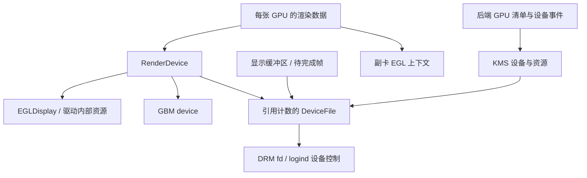
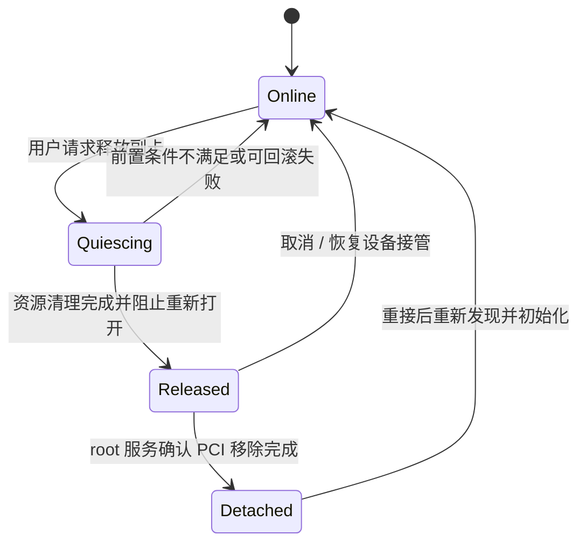

# GNOME / Mutter 运行时释放外接 GPU：源码研究与本机验证报告

日期：2026-11-05（Asia/Shanghai）。目标：在 Wayland 下保留当前应用窗口、保留 eGPU 日常显示输出能力，并在带走笔记本前安全移除 NVIDIA eGPU。

## 结论与建议

**现有管理服务没有可直接调用的“让 Mutter 释放指定 GPU”接口，但 Mutter 内部已经有副卡渲染资源回收机制。值得先做一个小范围、带日志的回收验证补丁，再决定是否开发完整的逻辑离线功能。**

此前“只能修改整个合成器才能开始尝试”的表述过于笼统。更准确的分层结论是：

| 问题 | 本次结论 | 证据性质 |
| --- | --- | --- |
| 切 TTY 能否保留桌面并解除本机 GPU 占用？ | 能返回原桌面，但未解除占用 | 已实机验证 |
| eGPU 是否在负责整个 GNOME 桌面的主渲染？ | 本次会话主 GPU 是 AMD；NVIDIA 是后加入的副卡 | 本机 journal |
| Mutter 是否完全没有 GPU 资源释放代码？ | 有内部回收和对象销毁代码 | 已核对源码 |
| 现有回收是否足以让这张 NVIDIA 卡完全释放？ | 尚未证明；需要运行时插桩 | 待验证 |
| 仅修改 Mutter，能否迁移所有已打开应用的 GPU 资源？ | 不能据此作保证；客户端持有自己的资源 | 协议分析与本机多进程占用 |
| 能否现在把检查放宽，直接尝试卸载？ | 不应作为已验证方案交付 | 当前仍存在明确占用与驱动限制 |

建议首个研究目标收敛为：**AMD 继续合成桌面，NVIDIA 无外屏、无业务客户端占用时，验证能否释放 Mutter 自身的 NVIDIA 渲染资源。** 这还不是完整安全拔卡，更不是任意应用无感跨 GPU 迁移。

## 1. 研究范围与可复现基线

本机组件：

| 组件 | 版本 / 状态 |
| --- | --- |
| 系统 | Ubuntu 26.04.1 LTS |
| GNOME Shell | 50.1-0ubuntu1.4，Wayland |
| libmutter | 50.1-0ubuntu2.5 |
| 内核 | 7.0.0-42-generic |
| NVIDIA 开源内核驱动及用户态包 | 595.99.02-0ubuntu0.26.04.1 |
| Xwayland | 2:24.1.10-1 |
| GTK | 4.22.4+ds-0ubuntu0.1 |
| 外接卡 | RTX PRO 5000 Blackwell，PCI ID 10de:2bb3 |
| 桌面主 GPU | AMD，当前 DRM 节点 card1 |

源码使用 Git 固定提交，避免将后续变化混入结论：

- Mutter 50.1：`8e9bb806da4a6a4fc87aa4a481b228dba6735cbd`。
- 对照 main：`432c167ef2de37a708140b02e29881646fc9c13c`，提交日期 2026-10-28；本次在 2026-11-05 获取。
- 下载 Ubuntu `mutter_50.1.orig.tar.xz` 和 `mutter_50.1-0ubuntu2.5.debian.tar.xz`，在临时目录成功应用发行版全部 **37 个补丁**。
- 比较 renderer-native、backend-native、renderer、render-device、kms、udev 六个核心源文件：Ubuntu 补丁应用后，这六个文件与上述上游 50.1 文件逐字节一致。

来源：[50.1 固定提交](https://github.com/GNOME/mutter/tree/8e9bb806da4a6a4fc87aa4a481b228dba6735cbd)、[对照 main 固定提交](https://github.com/GNOME/mutter/tree/432c167ef2de37a708140b02e29881646fc9c13c)、[Ubuntu 原始源码](https://archive.ubuntu.com/ubuntu/pool/main/m/mutter/mutter_50.1.orig.tar.xz)、[Ubuntu 发行版补丁](https://archive.ubuntu.com/ubuntu/pool/main/m/mutter/mutter_50.1-0ubuntu2.5.debian.tar.xz)。

临时研究目录位于 `/tmp`；项目内只保存本报告和脱敏证据，不复制上游源码进入本项目发行内容。未编译或替换系统 Mutter，未重启桌面，未执行 GPU 移除。

## 2. 本机实验：已经证明了什么

有效实验为 tty2 → tty3 → tty2。TTY 内约第 2.14、4.21、6.27、8.32、10.14 秒取得五次完整采样。PCI 设备始终存在，无提前退出错误，约第 10.23 秒返回原桌面。

五次采样中的持有情况一致：

| 进程 | 持有的相关设备 |
| --- | --- |
| gnome-shell | renderD129、nvidia0、nvidiactl |
| Xwayland | card0 |
| ptyxis | renderD129、nvidia-modeset、nvidia0、nvidiactl |

这里的 card/render 编号仅描述本次实验，不能硬编码进功能。**打开句柄证明存在引用，不等于该进程此刻正在执行 GPU 工作，也不直接说明引用来自哪一层库。**

GNOME 日志显示 AMD card1 因内屏存在而被选作 primary；随后才为 NVIDIA card0 创建 GBM renderer。因此本次不应把问题归因于“桌面主 GPU 是 NVIDIA，需要先迁移整个主渲染上下文”。

首次 tty1 实验另有第二个 GNOME 会话出现，并提前结束，不作为纯 TTY 结论的依据。修正后的 tty3 实验才是上述有效证据。

项目内证据：[脱敏采样与源码指纹](evidence/2026-11-05-vt-gpu-observations.json)。原始报告为 `/var/tmp/egpu-vt-demo-pcmp9_w9/report.json`，证据文件记录其 SHA-256。进程 PID、主机名及完整 journal 不写入公开报告。

## 3. GPU 资源在 Mutter 内的生命周期

### 3.1 加入一张 GPU 不以“有外屏”为前提

原生后端收到 DRM 设备加入事件后，检查 ignore 标签、建立 KMS/GPU 对象，通知渲染器。此路径没有要求设备必须已有正在输出的显示器。因此“无外屏”与“未初始化这张卡”不能等同。[原生后端设备加入路径](https://github.com/GNOME/mutter/blob/8e9bb806da4a6a4fc87aa4a481b228dba6735cbd/src/backends/native/meta-backend-native.c#L538)

本机日志中“桌面先启动、随后创建 NVIDIA GBM renderer”的时序与此路径一致；这是源码与实测互相支持的部分。

### 3.2 需要释放的是对象链，而非一个文件描述符

正常销毁时，RenderDevice 的 dispose 会终止其 EGLDisplay，finalize 释放 DeviceFile；GBM 子类清理 GBM device。DeviceFile 则只有在引用计数归零时，才释放相应 logind 控制并关闭 fd。[RenderDevice 生命周期](https://github.com/GNOME/mutter/blob/8e9bb806da4a6a4fc87aa4a481b228dba6735cbd/src/backends/native/meta-render-device.c#L220)、[GBM 生命周期](https://github.com/GNOME/mutter/blob/8e9bb806da4a6a4fc87aa4a481b228dba6735cbd/src/backends/native/meta-render-device-gbm.c#L292)、[DeviceFile 释放](https://github.com/GNOME/mutter/blob/8e9bb806da4a6a4fc87aa4a481b228dba6735cbd/src/backends/native/meta-device-pool.c#L308)

显示缓冲区也会持有 DeviceFile 引用，必须等其生命周期结束。因此“调用一次 close”不等同于整个对象链安全销毁。[DRM buffer 生命周期](https://github.com/GNOME/mutter/blob/8e9bb806da4a6a4fc87aa4a481b228dba6735cbd/src/backends/native/meta-drm-buffer.c#L333)

需要强调：`/dev/nvidia0`、`nvidiactl` 等句柄可能由 NVIDIA 用户态库内部建立。仅凭 Mutter 的 DeviceFile 引用清零，不能断言这些库内部资源一定全部释放；这一点需实机验证。

## 4. 为什么切 TTY 没有效果

追踪到的暂停调用链为：原生后端暂停输入、显示器管理和 DRM lease；父后端暂停 renderer 和 udev。renderer 的暂停主要是抑制各 view 的 frame clock，而不是销毁渲染对象。[原生后端暂停](https://github.com/GNOME/mutter/blob/8e9bb806da4a6a4fc87aa4a481b228dba6735cbd/src/backends/native/meta-backend-native.c#L983)、[父后端暂停](https://github.com/GNOME/mutter/blob/8e9bb806da4a6a4fc87aa4a481b228dba6735cbd/src/backends/meta-backend.c#L609)、[renderer 暂停](https://github.com/GNOME/mutter/blob/8e9bb806da4a6a4fc87aa4a481b228dba6735cbd/src/backends/meta-renderer.c#L300)

显示器管理器的 pause 断开资源变化处理，udev pause 屏蔽事件处理器；它们并不执行 RenderDevice 销毁。恢复时又会重新连接处理并更新 KMS 资源。[显示器管理器暂停](https://github.com/GNOME/mutter/blob/8e9bb806da4a6a4fc87aa4a481b228dba6735cbd/src/backends/native/meta-monitor-manager-native.c#L411)、[udev 暂停](https://github.com/GNOME/mutter/blob/8e9bb806da4a6a4fc87aa4a481b228dba6735cbd/src/backends/meta-udev.c#L394)、[KMS 恢复](https://github.com/GNOME/mutter/blob/8e9bb806da4a6a4fc87aa4a481b228dba6735cbd/src/backends/native/meta-kms.c#L282)

**工程判断：暂停是为了恢复原图形会话，保留图形状态属于其正常用途；不能把它当作 GPU 弹出协议。** 这与 tty3 中渲染句柄保持不变的实验相符。单纯延长 TTY 停留时间没有明确的源码依据。

## 5. 现有“未使用 GPU 回收”机制：最值得验证的入口

渲染器确实有 `free_unused_gpu_datas()`。它保留 primary、当前 views 使用的 GPU，以及尚有 lingering onscreen 的 GPU，移除其余每卡渲染数据。调用点包括 modeset 更新完成后的路径，以及旧 onscreen 最终释放后的 idle 回调。[回收判定](https://github.com/GNOME/mutter/blob/8e9bb806da4a6a4fc87aa4a481b228dba6735cbd/src/backends/native/meta-renderer-native.c#L836)、[modeset 后回收](https://github.com/GNOME/mutter/blob/8e9bb806da4a6a4fc87aa4a481b228dba6735cbd/src/backends/native/meta-renderer-native.c#L966)

这说明源码已有副卡资源销毁的基础，不需要把“销毁 EGL/GBM 对象”全部从零实现。但**内部缓存回收不是已完成的、可对外保证的 GPU 安全移除事务**。

以下是待验证假设，不能写成已确认根因：

| 假设 | 为什么值得查 | 如何区分 |
| --- | --- | --- |
| H1：无外屏副卡热加入后，回收没有及时触发 | 加入时初始化资源；无显示变化时未必走到对应回收点 | 记录每次加入、modeset 完成及回收调用的顺序 |
| H2：回收运行了，但某个 view / lingering onscreen 仍把副卡判为使用中 | 已有回收依据内部对象，而非仅依赖连接器状态 | 打印每个保留理由及相关对象生命周期 |
| H3：Mutter 对象已销毁，但 NVIDIA 用户态库仍保留设备引用 | 驱动库可持有额外 fd；本机映射中包含 Mesa 与 NVIDIA 库 | 对比销毁日志、EGL/GBM 清理返回值、同进程 fd 变化 |

`startup_render_devices` 在初始化后会被清理，不能仅看到这个缓存名称就把它判为永久持有来源。[初始化后清理](https://github.com/GNOME/mutter/blob/8e9bb806da4a6a4fc87aa4a481b228dba6735cbd/src/backends/native/meta-backend-native.c#L199)

截至本报告，未取得运行时对象引用轨迹，H1/H2/H3 不能定案。

## 6. 释放之后，为什么还可能重新打开

KMS 层有按需打开设备和 fd hold 计数；计数归零可释放 DeviceFile，但后续设备状态查询可以再打开。这意味着一次成功关闭 fd，不自动意味着之后不会再开。[按需打开](https://github.com/GNOME/mutter/blob/8e9bb806da4a6a4fc87aa4a481b228dba6735cbd/src/backends/native/meta-kms-impl-device.c#L307)、[hold 计数释放](https://github.com/GNOME/mutter/blob/8e9bb806da4a6a4fc87aa4a481b228dba6735cbd/src/backends/native/meta-kms-impl-device.c#L2451)

后端有添加 GPU 的清单操作；KMS 也监听真实设备移除，但相应处理是刷新资源，并非面向管理器的“先主动放弃某张卡，再允许删除 PCI 设备”接口。[GPU 清单加入](https://github.com/GNOME/mutter/blob/8e9bb806da4a6a4fc87aa4a481b228dba6735cbd/src/backends/meta-backend.c#L1926)、[设备移除事件处理](https://github.com/GNOME/mutter/blob/8e9bb806da4a6a4fc87aa4a481b228dba6735cbd/src/backends/native/meta-kms.c#L327)

所以完整功能至少还需要一种“此卡已逻辑离线，禁止后台重新探测或重新分配”的状态。对象继续保留还是从清单删除，都需要配套恢复路径；不能只从一个哈希表删除数据就宣称热拔支持完成。

动态添加 `mutter-device-ignore` 也不是已有的运行时弹出接口：现有设备在 add 路径会先被识别为已存在，普通 change 事件没有一条对称的“销毁已接管 GPU”处理。[设备事件分发](https://github.com/GNOME/mutter/blob/8e9bb806da4a6a4fc87aa4a481b228dba6735cbd/src/backends/meta-udev.c#L335)、[已有设备与 ignore 检查](https://github.com/GNOME/mutter/blob/8e9bb806da4a6a4fc87aa4a481b228dba6735cbd/src/backends/native/meta-backend-native.c#L611)

## 7. “保留窗口”与“保留任意 GPU 上下文”是两件事

如果 AMD 主渲染保持运行，应用在 AMD/CPU 上绘制，Wayland 连接不被断开，则释放一个未使用 NVIDIA 副卡，具备保留这些窗口的工程基础。**这是合理的研发目标，尚未在本机卸载验证。**

但本机已有 Ptyxis 和 Xwayland 自己打开显卡。Mutter 释放自己的引用，不会自动关闭其他进程的 EGL/GL、DRI 或计算资源。即使终端的文字内容只在内屏显示，也不能据此认定终端没有 GPU 引用。

Wayland DMA-BUF feedback 可以表达设备偏好变化；它不是一个强制所有客户端迁移 GPU 上下文、完成后统一回复的协议。已有 buffer 还有独立生命周期，设备消失后的导入失败也有协议约束。[linux-dmabuf 协议原文](https://github.com/wayland-mirror/wayland-protocols/blob/main/stable/linux-dmabuf/linux-dmabuf-v1.xml)

据此作出的工程边界：

- AMD/CPU 应用窗口应作为必须保留的对象。
- 真正在 NVIDIA 上运行的应用，需要应用主动重建资源、提供迁移能力，或由用户结束/重启；不能承诺所有窗口和 GPU 内部状态同时无感保留。
- Xwayland 是多个 X11 应用共享的图形服务；不能简单把“重启 Xwayland”当作无损释放方案。
- 通过调试器向进程注入 close、冻结进程或强制解绑驱动，都不等价于按对象生命周期释放资源。

目前“所有窗口绝对保留”与“任何占用情况下立即拔卡”不能作为同一个已实现产品承诺。

## 8. 上游进展与可复用程度

### 当前接口与 main 对照

本机 DisplayConfig introspection 与 50.1 接口文件均没有指定 GPU 的 release/eject 方法。对照本次获取的 main，仍可见副卡回收机制、设备加入和 ignore 判断；未在所检查的接口与后端中找到可直接用于本目标的主动弹出事务。[DisplayConfig 定义](https://github.com/GNOME/mutter/blob/8e9bb806da4a6a4fc87aa4a481b228dba6735cbd/data/dbus-interfaces/org.gnome.Mutter.DisplayConfig.xml)、[对照 main 后端](https://github.com/GNOME/mutter/blob/432c167ef2de37a708140b02e29881646fc9c13c/src/backends/native/meta-backend-native.c)、[对照 main 渲染器](https://github.com/GNOME/mutter/blob/432c167ef2de37a708140b02e29881646fc9c13c/src/backends/native/meta-renderer-native.c)

这是源码审计范围内的结论，**不代表穷尽了所有未合并分支或 MR**。GNOME GitLab 部分议题/MR 页面本次无法访问，未将这些不可读页面的内容作为结论依据。没有证据支持仅升级某个桌面包即可解决本机问题。

### GPU reset recovery

2026 年的上游研究涉及图形上下文失效后的重建，包括 Cogl、字体、背景等资源恢复；这对理解生命周期有参考价值。但 GPU 重置后继续使用原设备，与主动离线一张副卡、关闭所有引用并允许物理移除，目标不同。[开发者进展记录](https://blogs.gnome.org/anonymoux47/2026/07/02/gpu-reset-recovery-in-mutter-a-progress-update/)

不能把“存在 GPU reset recovery 研究”解释为“本机当前已有可用热拔补丁”。本报告也未验证该研究的完整合并状态及 NVIDIA Blackwell 兼容性。

## 9. 驱动侧边界与当前管理器的检查能力

NVIDIA 595.99.02 官方文档没有保证 eGPU 正在使用时的热拔稳定性；其中关于 X screen 的设置不能直接当成 Wayland 释放方法。[NVIDIA eGPU 文档](https://download.nvidia.com/XFree86/Linux-x86_64/595.99.02/README/egpu.html)

本机 NVIDIA 源码中，`nv_pci_remove_helper()` 存在等待 usage_count 归零的分支，但该段条件明确排除了 `is_external_gpu`。因此**不能把这一段循环直接断言为本机 eGPU 之前卡住的原因**。此前异常还包含 Xid 79 / GSP 超时，未取得足以确定具体阻塞栈的证据。核对文件：`/usr/src/nvidia-595.99.02/nvidia/nv-pci.c`，约 2331 行。

当前管理器的 `/proc/*/fd` 扫描有两种局限：

1. NVIDIA 共享控制节点，以及对全部 `/dev/nvidiaN` 的保守匹配，在多张 NVIDIA 卡同时由驱动管理时可能把其他 GPU 的使用者也算入阻碍；本机内置卡已 VFIO 隔离，仍需保留该通用边界。
2. “未找到设备节点 fd”不是内核资源全部释放的充分证明：DMA-BUF、映射、未完成 fence、驱动内部引用及采样后的新打开请求，还需要分别处理。

所以未来应把“compositor 已回报逻辑离线”“应用占用已消失”“驱动完成移除”作为三个独立阶段，最终以实际移除完成为可拔线条件。

## 10. 建议的研发路径

### 阶段 A：先解释引用为什么没有消失

制作独立实验构建，不替换用户日常会话。先记录而非强制释放：

| 插桩位置 | 应记录什么 |
| --- | --- |
| 副卡加入 / 每卡渲染数据建立 | PCI/设备身份、是否 primary、创建时显示输出状态 |
| 未使用副卡回收 | 进入次数、每卡保留理由、view / lingering onscreen 数量 |
| 渲染数据与 RenderDevice 销毁 | 上下文、EGLDisplay、GBM 清理时序与结果 |
| DeviceFile acquire/release | 受控的调试引用增减、fd、设备路径 |
| KMS hold/unhold 与重新打开 | 调用原因、未完成提交和回调、重新探测来源 |

只在没有目标卡 view、没有残留 onscreen、不是 primary、没有待完成目标卡提交时，请求一次现有回收逻辑；在主线程安全时机执行，协调 KMS 线程和 EGL 当前上下文，不能从任意 D-Bus 回调直接销毁对象。

**阶段 A 不删除 PCI、不卸载驱动、不修改主渲染卡。** 成功标准是解释 H1/H2/H3，并观察到 GNOME 自身的目标卡引用消失且 AMD 桌面继续正常运行；若引用不消失，记录原因，不进入下一阶段。

该方案是研究设计，尚无已编译、可安装或通过硬件测试的补丁。

### 阶段 B：建立可恢复的副卡逻辑离线状态

只有阶段 A 证明资源能正确释放，才值得增加受限的会话控制接口：

这是拟议状态机，不是现有 Mutter API。至少应满足：

- 拒绝 primary GPU、承载内屏的 GPU，要求另一张 GPU 的有效桌面输出。
- 先停用目标卡显示输出，处理 lease、录屏、光标与待完成帧；保留非目标卡的图形上下文。
- 离线后禁止热插拔刷新、恢复探测、模式查询及新显示分配再次打开目标卡。
- 使用本次设备实例标识防止 PCI 地址复用；不能只靠 card0 或旧 BDF。
- 超时返回明确错误与可恢复状态；不能在主线程无限等待驱动。
- 若对象保留为离线元数据，补齐“再上线”的重新探测；若对象被删除，补齐后端清单、引用和重复加入的生命周期。

接口只应是当前用户会话内的受约束操作，不开放任意对象销毁或脚本求值。系统级移除仍交给现有 root 服务并进行 Polkit 授权。

### 阶段 C：与应用占用及 root 移除串联

Mutter 返回 Released 后，root 服务重新扫描所有相关进程；仍有 Ptyxis / Xwayland / CUDA 客户端占用就停止，显示具体阻碍，不杀应用、不伪造成功。

确认释放后才执行受限的 GPU / 音频 PCI 移除。移除失败而设备仍在时，应尝试恢复逻辑接管；设备已消失时不能盲目回滚成 Online。必须覆盖中断、服务重启、睡眠及用户取消。

这种实现可以争取让大量 AMD/CPU 窗口保留，但不会自动给任意 GPU 应用增加迁移能力。

## 11. 进入实机卸载前的验证门槛

| 场景 | 最少验证内容 |
| --- | --- |
| 副卡无外屏、无客户端，登录前已接入 | 回收可完成，AMD 桌面与已有窗口保持 |
| 登录后热插入，无外屏 | H1 场景可重现并定位，回收不依赖碰巧更改显示设置 |
| 外屏启用后再停用 | 旧帧、onscreen 与回调最终释放，外屏可重新启用 |
| 有 Ptyxis / Xwayland / CUDA 占用 | 明确拒绝系统移除，不关闭窗口 |
| lease / 录屏 / 远程桌面 | 不遗漏持有者；未支持时明确阻止 |
| TTY、睡眠及唤醒 | Released 卡不被恢复路径意外重新打开 |
| 取消、超时、服务重启 | 不留下永久失联的图形设备或误报可拔线 |
| 重插及重复周期 | 重新发现正确实例，恢复显示/CUDA，无旧对象重复加入 |

判断不应只看进程名称消失：需要保留原 GNOME / Xwayland 会话、应用连接和实际窗口内容，确认内屏持续绘制；同时核对对象引用、GPU 句柄及驱动事件。物理移除应当是最后阶段的独立硬件实验，不用它来试探是否还有资源。

## 12. 对本项目的最终判断

**继续研究有价值，且已找到比“强制解绑”更具体的源码入口；目前还没有可交付的免注销安全拔卡实现。**

最优先的工作是阶段 A 的引用插桩与无外屏副卡回收 PoC。若能释放合成器自己的资源，再开发显式逻辑离线和重新接管；若卡在 NVIDIA 用户态库内部，则需要缩小复现并向相应上游定位，而不是继续叠加 systemd / TTY 脚本。

本报告交付的是已验证事实、源码分析和研发方案。没有改动系统服务、安装合成器补丁，或把尚未验证的路径加入“安全移除”按钮。

## 13. 后续 PoC 实验记录

以上为研究报告初次完成时的状态。随后阶段 A 补丁已在用户私有目录编译，但初版登录覆盖导致 GNOME 类型重复注册，用户通过 TTY 禁用后恢复。
已定位并修复私有 companion 库与系统 GI 库混载，增加隔离的 GNOME JS 启动验证及单次试用保护。详见 [登录故障记录](2026-11-05-poc-login-failure.md)。
修复后的实际 AMD/NVIDIA 会话尚未重测，阶段 A 的硬件回收目标仍未完成，H1/H2/H3 也尚未因本次启动修复得到证实。
